# Design: Starlit Account

## Starting point

The handoff listed the features to cover. Reference captures of another
product were used only for the feature list and to judge how much each screen
holds. Nothing from them (layout, components, colours, assets) is used, and
none of them is stored in this repository.

The visual language comes from Starlit itself, as published on
starlit.rrmtools.uk:

* page `#06070F`, panels `#0B0D1A` / `#090B17`, hairlines `#161A33`
* text `#EEF0FA`, secondary `#A2A8C3`, muted `#7C83A3`, accent `#45D6EB`, links `#7FE3F2`
* Bricolage Grotesque for headings, Geist for text, Geist Mono for numbers,
  ids and eyebrow labels. These are the website's self-hosted OFL files,
  copied in at build time with their licences.
* the website's hairline "cells", pill buttons, mono eyebrows and pill badges

## Three directions

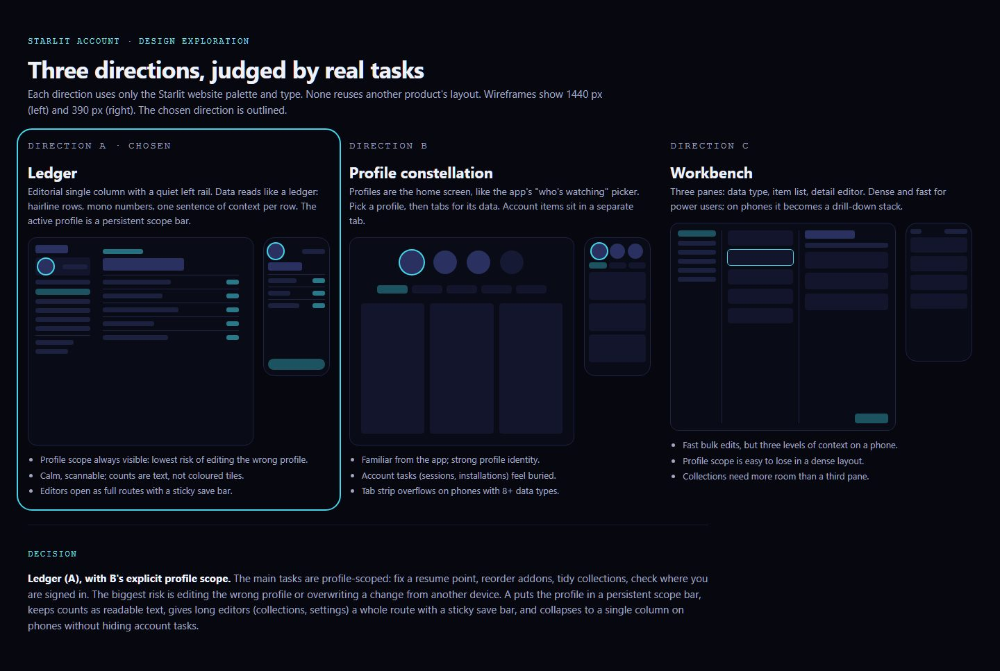

([source](design/directions.html), a design document that isn't shipped)

| | A · Ledger (chosen) | B · Profile constellation | C · Workbench |
| --- | --- | --- | --- |
| Idea | Editorial column, quiet left rail, data as ledger rows | The app's "who's watching" picker as home, then tabs | Three panes: type, list, editor |
| Profile scope | Always visible in the rail and the top bar | Strong, but lost once you go into tabs | Easy to lose |
| Account tasks | A separate "Whole account" group | Hidden behind an Account tab | A third level |
| Phone | One column, a menu dialog, sticky save bar | Tab strip overflows with 9 sections | Three levels of drilling down |
| Long editors | A full route with short steps | Modal or tab | Squeezed into a third pane |

**Decision: A, with B's explicit profile scope.** The tasks people actually
come for are mostly about one profile: fix a resume point, reorder addons,
tidy collections, check where the account is signed in. The two expensive
mistakes are editing the wrong profile and overwriting another device's
change. A answers both: a persistent "Managing: <profile>" control, and staged
edits with a save bar that turns 409s into a review step.

## Before and after

**Before.** There's no account page on the web. The website's Account & sync
page explains syncing but can't manage anything (it has no JavaScript by
design). Everything has to be done in the app on each device.

| Desktop | Phone |
| --- | --- |
| 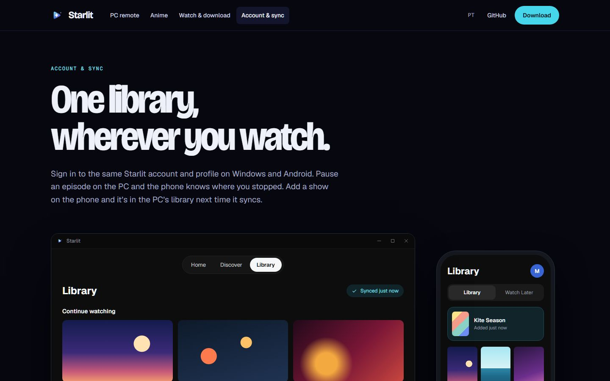 | 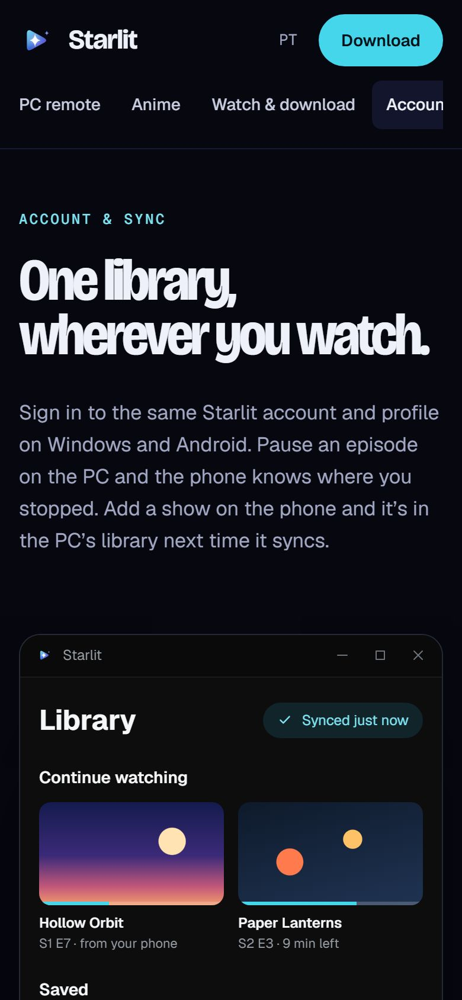 |

**After** (mock build, synthetic accounts):

| | |
| --- | --- |
| 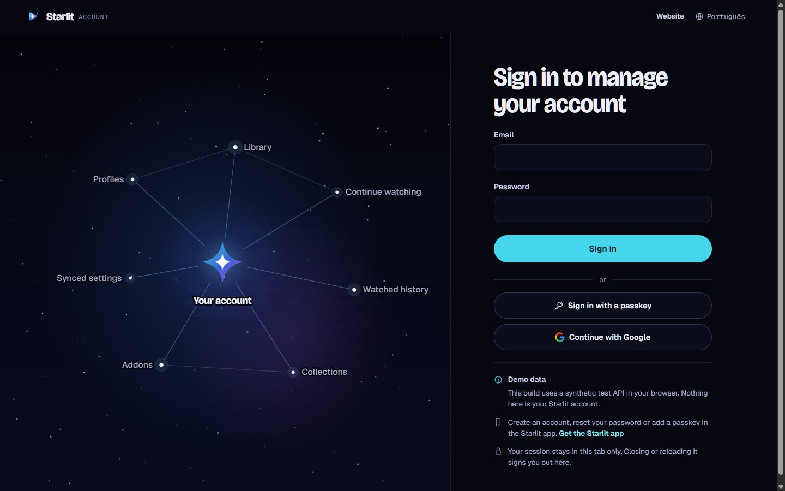 | 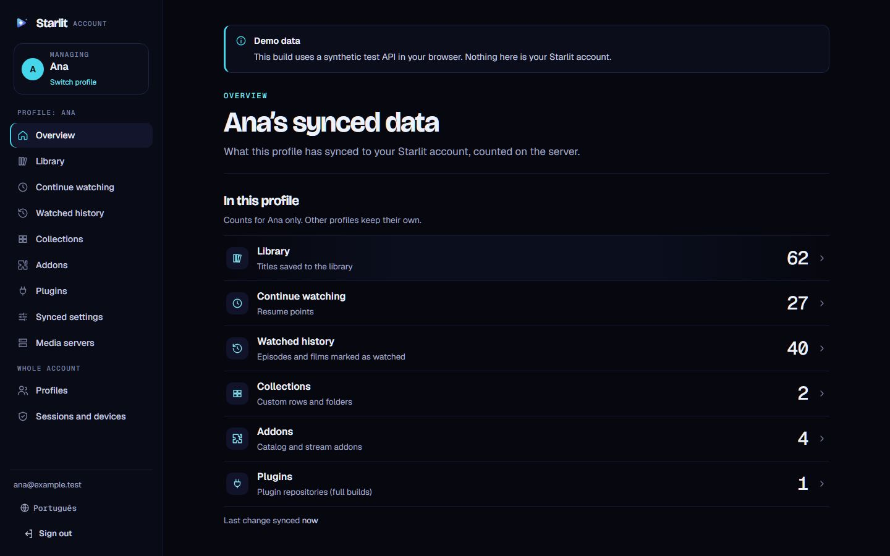 |
| 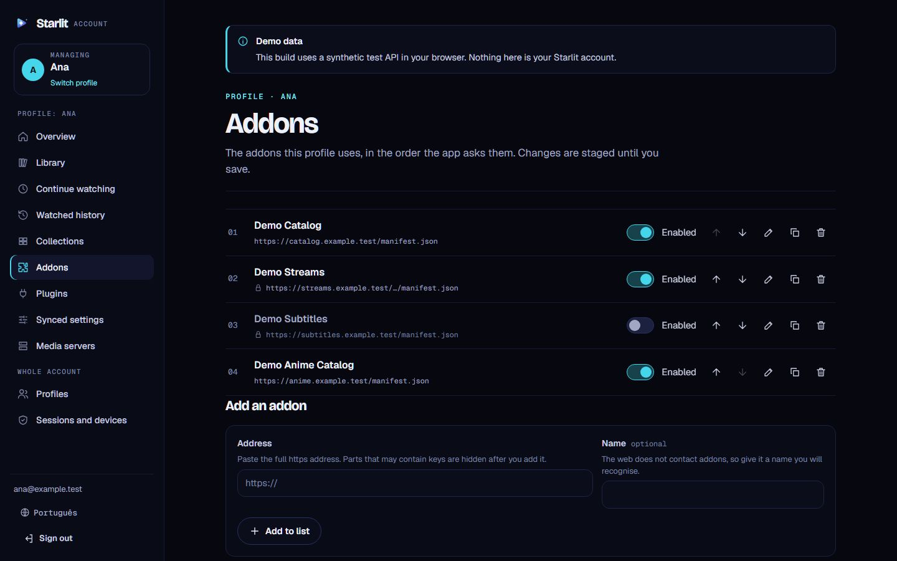 | 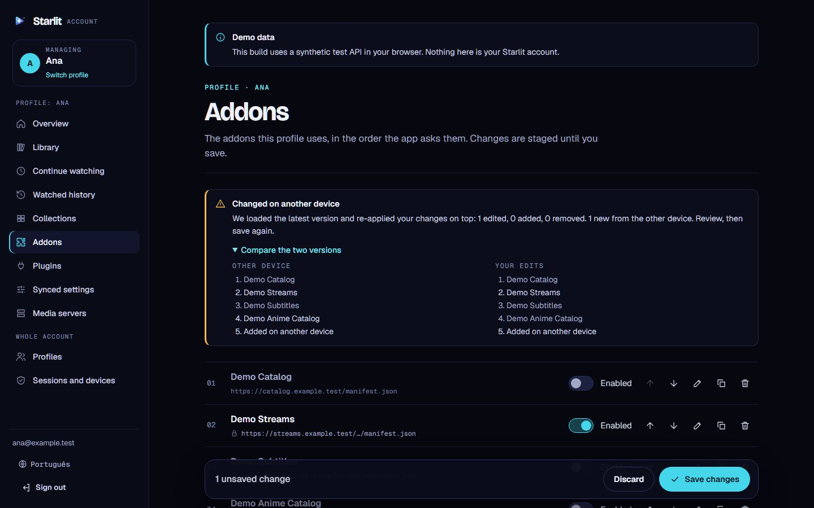 |
| 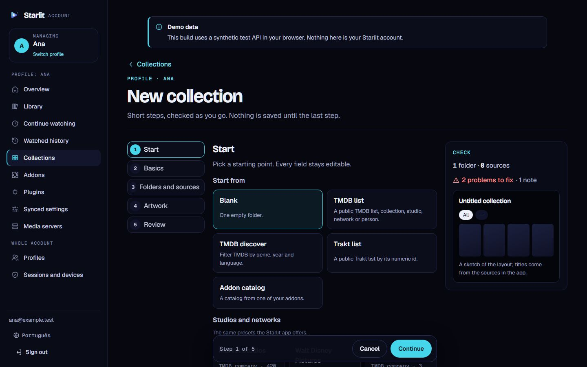 | 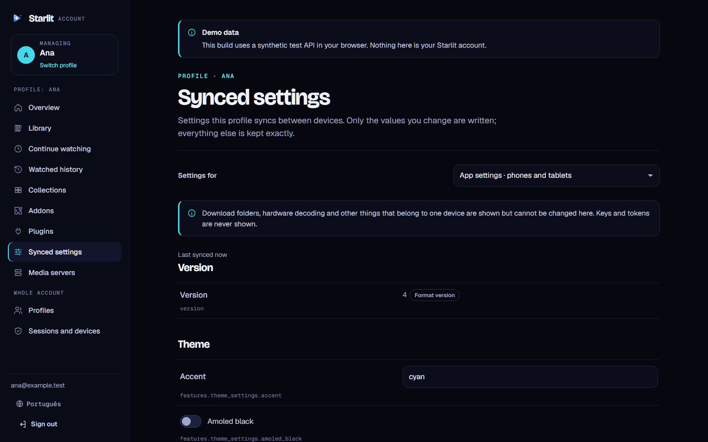 |
| 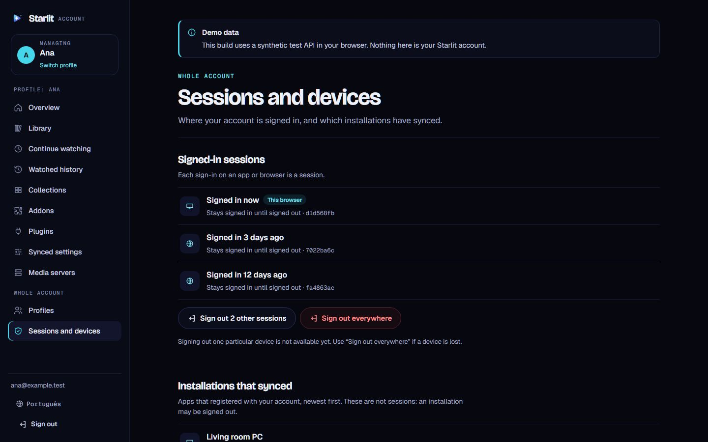 | 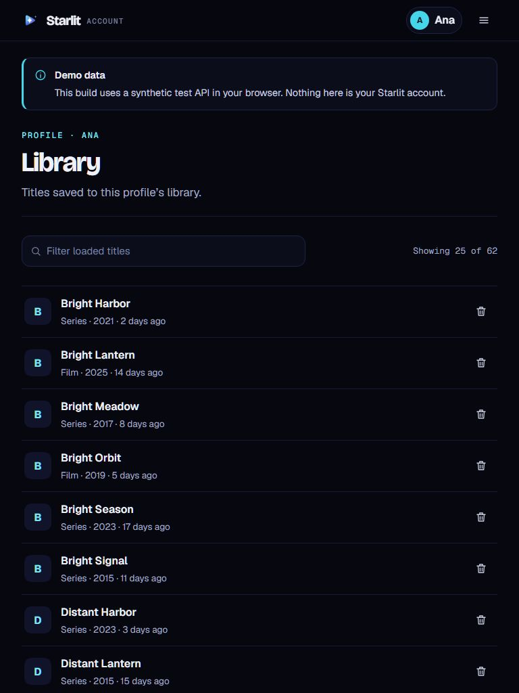 |

| 390 px | | | |
| --- | --- | --- | --- |
| 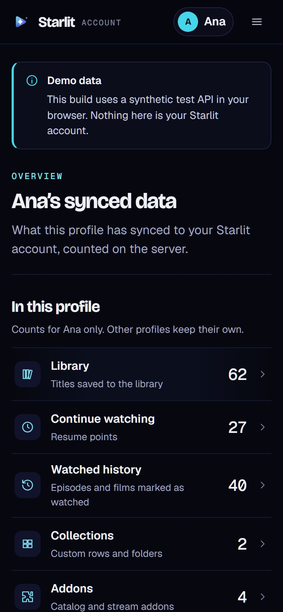 | 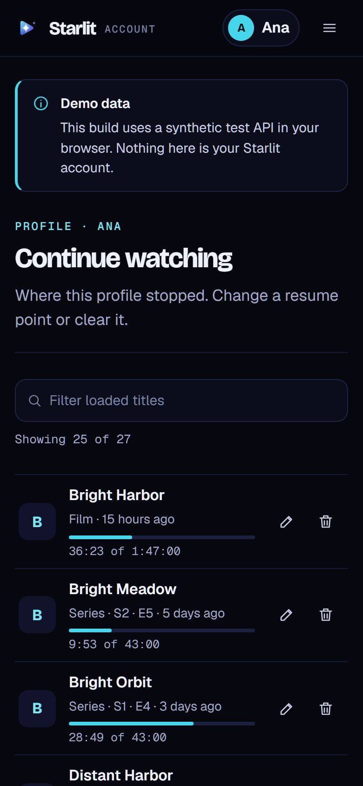 | 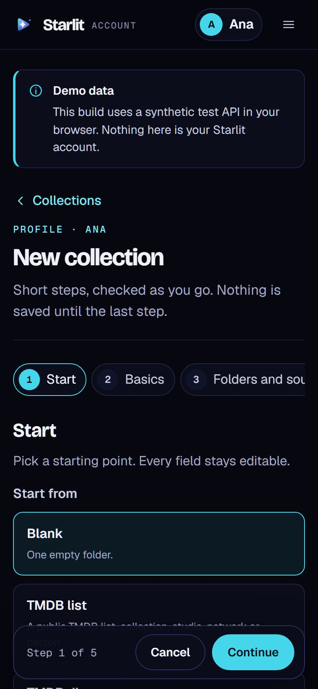 | 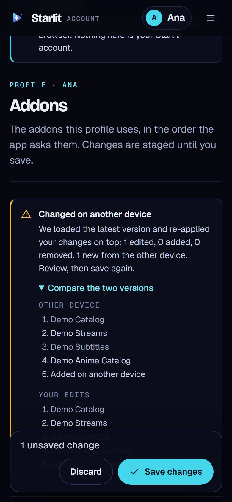 |

## Layout

* **1440 px.** A 264 px rail (brand, profile scope, "Profile: …" section
  group, "Whole account" group, email, language, sign out) and a content
  column capped at 980 px. The collection editor widens to 1280 px:
  190 px step list, form, and a 300 px check and preview panel.
* **768 px.** A sticky top bar (brand, compact profile control, menu) and one
  column. The editor's steps become a horizontal pill row.
* **390 px.** The same, with 16 px gutters. Dialogs become bottom sheets, and
  the save bar and the editor footer stay at the bottom where a thumb can
  reach them. The E2E tests check that nothing scrolls sideways on any page.

## The sign-in screen

The first thing people see, so it carries the one bold element of the app:
a night sky in which the account is the brightest star (the four-point star
and gradient of the Starlit mark), connected to stars named after what the
account manages: Profiles, Library, Continue watching, Watched history,
Collections, Addons, Synced settings. These are the navigation's own words,
so the picture previews what's behind the form. It's inline SVG built with
`h()` (no HTML strings), hidden from screen readers (the lede says the same),
and its lines draw in once on arrival unless reduced motion is on.

* **1024 px and up.** The sky fills the left of the screen and stays in view
  while the form column on the right scrolls. The form is left-aligned, with
  50 px fields and buttons.
* **Below 1024 px.** The sky becomes a 176–220 px band above the heading,
  without labels, and the lede is shown under the heading.
* **Quiet details.** No eyebrow label above the heading. The passkey button
  has a key icon and Google's "G" sits next to "Continue with Google". The
  shell's notices (read-only mode, offline) appear small under the form
  instead of above the page (`[data-banners]` in the view), and the notes
  about creating an account in the app and the tab-only session sit with
  them.

## The collection editor

A full page instead of a long modal: **Start → Basics → Folders and sources →
Artwork → Review**, one heading each, with Back and Continue in a sticky
footer. On wide screens a **Check** panel keeps counting problems and draws an
image-free sketch of the layout (tabs with grid, or rows; tile shapes;
emoji). Every problem in Review has a **Fix** button that jumps to the step
and focuses the exact field. Templates are blank, TMDB list, TMDB discover,
Trakt list, addon catalog, and the app's own 11 studio and network presets.
Artwork loads only when you press Preview, with `referrerpolicy=no-referrer`.
The JSON for the app is shown and can be copied.

## Ergonomics review

| Task | Before (app only) | Now | Notes |
| --- | --- | --- | --- |
| See what a profile has synced | Open each screen on a device | 1 page, 6 counted rows | Counts come from the server, per profile |
| Reorder addons | Per device, by touch | Keyboard up and down, one save | Focus stays on the moved row's button; position is announced |
| Fix a wrong resume point | Play the episode and seek | Edit the time (or slider), save | "Start over" and "Mark as finished" shortcuts |
| Build a collection | App dialog | 5 short steps with a live check | Validation the server doesn't do |
| React to a change from another device | Last write wins | Review screen, keep theirs or use mine | No silent overwrite |
| Sign out a lost device | Not possible per device | "Sign out everywhere" | Per-device sign-out isn't supported by the backend, and the UI says so |

Other choices:

* **Errors you can recover from.** Every load failure gets a specific title
  and Try again, and staged edits survive going offline.
* **Skeletons at final size** (row heights match the content), with a
  `role="status"` "Loading…" for screen readers.
* **Touch targets** are at least 36–44 px. The switches are native
  checkboxes with `role="switch"`.
* **Focus management.** The page heading takes focus after navigation. Dialogs
  are native `<dialog>` (focus stays inside, Esc closes) and give focus back
  to whatever opened them. Destructive dialogs focus Cancel first, and
  deleting a profile means typing its name.
* **Live region.** Saves, moves and removals are announced; the toast is
  just a visual echo of it.
* **Reduced motion** turns off the shimmer and the transitions.
  **Forced colours** get outlines on borders.
* **Language.** English and Portuguese (Portugal), with the same vocabulary
  as the website: "Addons", "Pontos de retoma", "Iniciar sessão".

## Known limits

* The page lists can only be filtered over the items already loaded, because
  the API has no search. The UI says this.
* Avatars use colour and initial only. Avatar images chosen in the app are
  kept, but not shown, so nothing is fetched from third parties.
* No real screen reader was run (see [TESTING.md](TESTING.md)). Automated
  axe checks and keyboard paths are covered.
