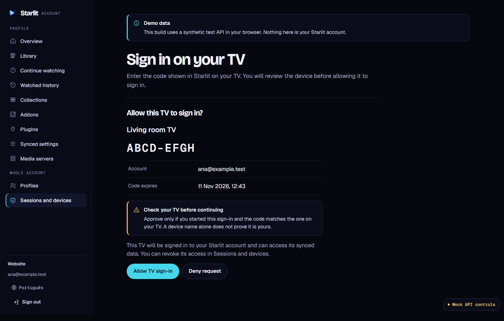
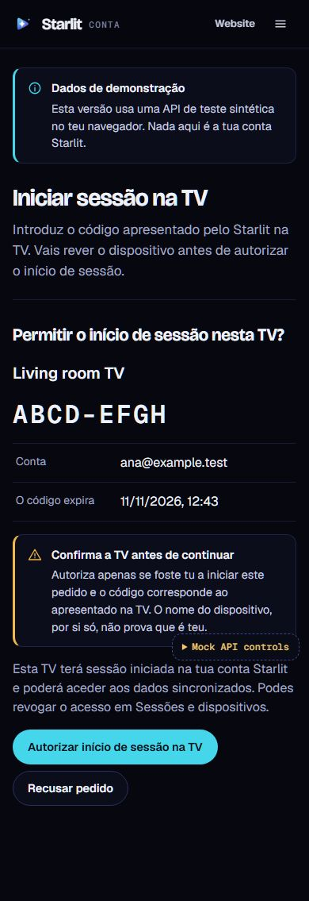

# TV account approval

`/account/tv` accepts a human code from `#code=XXXX-XXXX`, removes the entire
fragment immediately, and asks the visitor to sign in. The code alone grants
no access. A short-lived, tab-scoped intent containing only that code and an
expiry survives a Google redirect or reload. Account credentials and the
server-issued approval token remain in memory. No endpoint from a QR code is
accepted.

The visitor enters or reviews the code, then sees the TV name, code, account
email, expiry, and access explanation. Only an explicit **Allow TV sign-in**
or **Deny request** click submits `{user_code, approval_token, confirm:true}`.
Expired, completed, unknown, rate-limited and disconnected requests have
recovery messages. An uncertain response never produces a success message or
an automatic retry. Account-wide consent does not require choosing a profile.

The Sessions and devices screen lists authorized TVs and confirms individual
revocation using the service's session revocation endpoint. New-login
discovery can be disabled while existing devices remain visible and revocable.

## Rollout gates

Live builds default to `tvApprovalEnabled:false`. Only the exact build value
`STARLIT_TV_APPROVAL=1` enables these UI/API actions; this never enables profile
editing (`STARLIT_ACCOUNT_WRITES` remains independent). The combined build's
existing read-only editor requirements remain intact.

Before opting in on a staging build:

1. Install and verify the TV authorization service, TLS/CORS, configured public
   verification URI, and actual GoTrue session issuance/revocation. Its fixed
   `/tv/v1/*` routes must use the configured account API origin.
2. Verify authenticated account isolation, request expiry, one-use decisions,
   account-bound approval tokens, and revocation using two disposable accounts.
3. Confirm new-login discovery advertises `capabilities.tv_login:true` only
   when healthy. Discovery endpoints are validated against the fixed origin,
   path and protocol version. Redirects are rejected on API requests.
4. Complete a real TV QR/manual-code sign-in and revoke test, including TV
   restart and a rejected refresh after revocation. Confirm English and
   Portuguese on phone browsers and the TV's supported runtime.
5. Review the staging evidence before enabling the website flag in production.

This change does not deploy the service, website, or TV application. No live
account or physical TV acceptance was performed for this PR. Keep the flag
off until those integration gates pass.

## Automated evidence

`npm test` in `account/` covers disabled rollout without network calls, strict
discovery endpoint validation, request bodies/credentials/redirect policy,
short-lived code-only storage, fragment removal, expired/replay errors and
independent build flags. `test/e2e/tv.spec.mjs` uses synthetic services for
explicit consent, denial, expiry/replay, network recovery, Google callback
intent restoration, revocation with new linking disabled, mobile Portuguese,
overflow checks and axe accessibility checks.

| Desktop consent | Phone, Portuguese |
| --- | --- |
|  |  |
