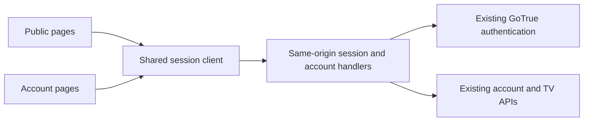

# Starlit website experience: audit and implementation plan

Status: DESIGN PROPOSAL. No runtime changes or deployment are included.

Audited 13 November 2026. Source baseline: website `3a1eabb224c9a52dbf913809c937f819462ad647`. The plan prioritizes a browser login that survives ordinary navigation, refresh and return visits, then aligns the public website and personal account area around the same identity and navigation rules.

## 1. Product brief and scope

The website has two legitimate jobs: help a visitor understand and install Starlit, and help an existing member manage account access and synchronized profile data. These modes can have different content densities while retaining the same global navigation, language and authentication state.

Assumption for this plan: playback remains in the installed apps. The website should not present library entries as playable in the browser unless a separately implemented capability supports that promise. Existing free access, approval requirements, profile ownership, conflict handling and app compatibility remain product constraints.

The intended outcome is one recognizable personal space: a member signs in once, visits a product or download page, returns to their account and continues the task. Authentication is account-wide; choosing a profile is necessary only for profile data.

This is an experience and architecture plan. It does not replace the visual identity, choose a new frontend framework, enable currently disabled writes, change signup policy, or authorize production migration.

## 2. Evidence and confidence

Two independent assessments covered design judgment and technical/browser evidence. The combined journey received a provisional Nielsen heuristic score of **22/40**. This is a design judgment rather than an instrumented usability study.

- The live public homepage, Portuguese route, account sign-in and current public configuration were inspected without a production login or account mutation.
- Live `account/lib/auth.js` and `account/app.js` matched the source baseline byte-for-byte by SHA-256 at inspection.
- Live configuration was `mode=live`, account writes disabled, TV approval enabled, Google web sign-in disabled and passkey web sign-in disabled. These flags are distinct from the installed apps' capabilities.
- Authenticated layouts were assessed using current source and committed synthetic screenshots. Those screenshots predate some shell additions and do not prove a current authenticated production journey.
- A local synthetic browser journey with mock account responses retained sign-in during internal account navigation and browser Back, but a new tab, reload, and Website → public home → My account each returned to sign-in. Browser storage contained only the profile preference, with no stored credentials or session cookie. Reloading sign-in also lost its in-memory intended return destination. These are controlled local findings, not an authenticated production test.
- Fourteen existing session-lifecycle, routing and passkey tests passed on an exported copy of the baseline. Refresh serialization, sign-out races and delayed old-account responses already have protection and must be preserved.
- A structural account code graph was generated and queried to trace authentication, routing, profile selection and view relationships. The graph tool reported a package/skill version mismatch; direct source inspection supplied the decisive evidence.
- The mechanical account-source detector reported four warnings: `side-tab` at `account.css:228,503`, and `overused-font` at `account.css:7,8`. The typefaces are part of the shared identity and the side accents have semantic uses; these are review signals, not evidence that those styles should be removed. The scan does not establish accessibility compliance for JS-generated screens.
- Live detector injection was attempted in an independent temporary browser tab and was blocked by the site's `script-src 'self'` policy. Production CSP was left intact and the temporary detector server was stopped.

### Findings

| Priority | Finding | Consequence | Evidence |
| --- | --- | --- | --- |
| P1 | Authentication exists only in document memory, with no startup restoration | Refresh and fresh account loads forget login; a visit to the public site can destroy the usable browser session | `account/src/lib/auth.js:1`, `account/src/lib/state.js:1`, `assets/site.js:30` |
| P1 | Public and account shells define navigation, home and language separately | The same product feels like two sites; `/pt/` to account can switch to English | `build.mjs:133`, `account/src/app.js:96,130`, `account/src/lib/i18n.js:5`; live locale journey reproduced |
| P1 | Public account entry is fixed and cannot reflect authentication | A member receives no consistent indication that the site recognizes them | `build.mjs:145`; public script has no session bootstrap |
| P1 | “Manage your account” leads to a view-only dashboard; recovery requires the app | Expectations exceed current web capability and a forgotten password becomes an installation detour | `account/src/lib/strings.js:67,79,89`; live notice and sign-in form |
| P2 | Nine profile destinations and two account destinations compete at the same level | Visitors must understand the storage taxonomy before choosing a task | `account/src/app.js:43`; overview repeats six categories |
| P2 | Ordinary sign-in selects a profile before account-wide work; only TV approval bypasses it | Checking account access can require an unrelated profile/PIN decision | `account/src/app.js:317`; compare account route flags with `finishSignIn` |
| P2 | Session references and installation records cannot identify a particular lost phone reliably | Broad sign-out is available, but users lack recognizable evidence for a narrow action | `account/src/views/security.js:25`; current session RPC returns ID/timestamps/current flag |
| P2 | Settings expose paths, format metadata and five scope/platform combinations | Normal preference changes resemble editing server data | `account/src/views/settings.js:14,69` |

Losing browser memory is not necessarily a GoTrue server logout. Repeated new sign-ins may therefore leave additional server sessions until explicitly ended; production accumulation was not measured. Browser Back may restore a preserved document through the browser's back-forward cache, so its behavior should not be described as universally logging out.

### Heuristic assessment

| Heuristic | Score /4 |
| --- | ---: |
| Visibility of status | 2 |
| Match with real-world tasks | 3 |
| User control and freedom | 2 |
| Consistency and standards | 1 |
| Error prevention | 3 |
| Recognition over recall | 2 |
| Efficiency | 2 |
| Minimalist design | 3 |
| Error recovery | 2 |
| Contextual help | 2 |
| Total | **22/40** |

The first-time visitor faces competing “Account & sync” and “My account” meanings. An interrupted phone visitor loses state on a fresh load. A returning member must repeat authentication and sometimes profile selection for a quick security task. The strongest elements are the established typography and brand, explicit profile scope, and existing protections against unsaved changes and concurrent edits.

## 3. Proposed information architecture

Keep a shared global header on every surface:

`Starlit [home]  |  Product  |  Download  |  Help  |  Language  |  Account`

Product groups the existing playback, remote, anime and sync explanations. The information page becomes “Sync across devices”; “Account” consistently means the personal account area. GitHub and policy links remain readily available in the footer and relevant help pages.

The account control has three explicit states: neutral checking state, signed-out “Sign in”, and signed-in account menu. Do not briefly announce “signed out” while restoring a valid session. The logo always returns to the localized public home; “Account home” is a separate labeled destination.

Within the account area, use four primary destinations:

| Destination | Contents | Scope |
| --- | --- | --- |
| Home | Clear next actions, available web capabilities, recent synchronization evidence | Account; selected-profile preview optional |
| Library | Saved, Continue watching, Watched, Collections as local tabs | Selected profile |
| Setup | Addons, Plugins, Media servers, with a short explanation of each | Selected profile |
| Devices | Current browser and other sign-ins; authorized TVs; previously synced installations | Account |

Profile selection sits above profile-owned content. Profile management and sign-in/security settings live in the account menu; synced preferences are a labeled Setup/settings subpage. Direct links remain available for experienced users. Account Home, Devices, credential recovery and TV approval never depend on profile selection or a profile PIN.

Account Home should lead with tasks such as “Review sign-ins”, “Connect a TV” and “Manage this profile's library”. Use last server update/last sync only when known. Counts and timestamps do not prove that all devices are online or fully synchronized; avoid a universal “Everything is synced” badge.

Preserve query-based account URLs initially. Map the existing `tab=library`, `progress`, `history`, `collections`, `addons`, `plugins`, `servers`, `settings`, `profiles` and `security` deep links into the new hierarchy. Keep old path bookmarks working and preserve action/id parameters. Route beautification can be a later change; it is not a prerequisite for a coherent experience.

## 4. Session architecture decision

**Recommend a small same-origin server session layer for the website.** Keep GoTrue as the identity authority and existing account RPCs as the data authority. Keep public pages statically generated. All authenticated browser operations move through explicit same-origin handlers; this is a real architecture change, not adding a cookie to the existing direct-token client.

### Contract

1. Set an opaque, random session identifier in a host-only `__Host-starlit_session` cookie with `Secure`, `HttpOnly`, `SameSite=Lax`, `Path=/`, and no `Domain`. Keep provider access/refresh tokens on the server, encrypted at rest, with hashed lookup identifiers. Use a restricted service role for session storage rather than exposing the store to browser database roles.
2. Expose a minimal `GET /api/session` response for the shared header. It returns authenticated status and only the account summary required for that control. It never returns provider tokens, library data or credentials. Boot the account router only after session restoration resolves.
3. Make browser account reads/writes, sign-out and TV approval use explicit same-origin handlers. Forward the member's identity to existing APIs so their ownership checks and conflict rules still apply. Do not create an arbitrary URL/RPC proxy or use elevated database credentials to bypass account authorization.
4. Serialize rotating-token refresh per server session, including concurrent requests from different tabs or service instances. Preserve epoch/generation checks so an old refresh or response cannot recreate a signed-out session or replace a newer login. A successful refresh extends a valid session according to the approved lifetime policy; it is not a fresh sign-in.
5. Validate session presence/revocation, not only an unexpired JWT, before privileged account work. Preserve the account API's current revocation checks and distinguish native token behavior from browser behavior. Existing native apps keep their own protected credentials; a shared account is not a universal shared session token.
6. Send `Cache-Control: private, no-store` on session, authentication and personal-data responses; bypass CDN caching for them and never cache a response that sets a session cookie. Public HTML can remain identical and cacheable for everyone, with the header populated from the separate private endpoint. Do not embed personal account details in shared cached markup.
7. Protect all state-changing cookie-authenticated operations against CSRF using strict Origin validation plus a bound CSRF token; SameSite alone is insufficient. Use bounded request schemas, existing abuse limits, no credential logging and per-request user context.
8. Coordinate sign-in/out and account changes across tabs using a token-free `BroadcastChannel` signal and server revalidation on focus/pageshow. Notification events are hints, not authorization. Clear protected UI and cancel stale requests promptly when the session ends.
9. Keep password, Google and passkey flows under the same session contract. Preserve the existing passkey RP identity and verified related-origin behavior. OAuth uses PKCE, bound one-time callback state, a fixed allowlist and a validated local return destination. Never place session tokens in a navigation URL. Preserve the validated intended destination across sign-in-page reloads using a server-bound pending intent rather than document memory alone.
10. Define restoring, authenticated, offline/retry, expired/revoked and signed-out UI states separately. A network timeout or temporary service error must not erase a valid session. Failed restoration renders a retry state rather than falsely asserting that the member signed out.

The proposed persistence default is a remembered browser login with a documented, server-enforced lifetime. A suggested policy is 30 days on a personal browser; finalize idle/absolute limits against the existing identity configuration before implementation. Shared-device mode and explicit sign-out require clear wording; browser-close cookie behavior alone cannot guarantee termination because browsers can restore sessions. Cookie lifetime must not exceed or substitute for actual server authorization.

The direct-token client with a maintained persistence adapter is a smaller alternative, but leaves refresh tokens readable by page JavaScript and requires coherent cross-tab rotation and public-page integration. Choose the same-origin layer because this site already has a server deployment and the required continuity spans public and account documents. It adds an operational component and session-store dependency, which must be covered by health checks, backup/retention policy and fail-closed behavior.

This recommendation is an architectural inference from the current app. OWASP documents the cookie/CSRF properties; Supabase documents rotating sessions, cache hazards and the limits of HttpOnly cookies with a direct browser SDK. A rich browser interface can use HttpOnly cookies here only because the server layer owns provider tokens and mediates authenticated API calls.

References: [OWASP session management](https://cheatsheetseries.owasp.org/cheatsheets/Session_Management_Cheat_Sheet.html), [Supabase sessions](https://supabase.com/docs/guides/auth/sessions), [server-side cache considerations](https://supabase.com/docs/guides/auth/server-side/advanced-guide), [sign-out semantics](https://supabase.com/docs/guides/auth/signout).

## 5. Core user journeys

| Journey | Required behavior |
| --- | --- |
| Return to account after visiting Download | The same browser session is restored; show the previous safe destination/profile without a new password prompt |
| Refresh a deep link | Restore authentication first, validate ownership/profile scope, then open the destination; preserve existing compatible URLs |
| Reload sign-in while following a deep link | Preserve the validated original task through a server-bound pending intent; do not silently fall back to Account home |
| Open Devices while signed out | Sign in, then open Devices directly; no profile chooser or PIN |
| Begin TV approval | Preserve the short-lived intent through login, show account and device consent, then approve explicitly; never silently approve a scanned code |
| Forget password | A visible recovery action beside the password field that reuses the existing identity recovery machinery and secure reset landing, with expired-link recovery and return to the original safe task |
| Create an account | Show actual signup/approval requirements and pending status; preserve the current policy rather than inventing immediate access |
| Follow Portuguese navigation | Public route establishes Portuguese on first entry; the explicit site-wide preference then stays consistent through account, recovery and return links |
| Session expires during editing | Keep the in-tab draft available for reauthentication, then reload revisions and resolve conflicts before any save; do not silently submit stale edits |
| Lose connectivity | Explain the connection problem and disable unsafe submissions; retain identity state until the server proves revocation/expiry |
| Sign out in another tab | Clear protected views on notification/focus, reject further requests and avoid browser-history resurrection of personal data |

Use one language precedence rule: explicit language action/entry context, then the remembered site preference, then browser language. Preserve the same localized destination when switching language or following Website/Home/Download links.

## 6. Page behavior and visual direction

Preserve Starlit's existing mark, Bricolage/Geist typography and cyan accent. Reuse header, menus, buttons, fields, notices and spacing tokens across the two builds. Marketing pages remain expressive; account screens emphasize quiet hierarchy and predictable controls.

- **Sign-in:** explain what is available before the form, place recovery beside the password input, and offer only methods enabled for the web. A disabled provider should have useful contextual explanation only when relevant. Move the session-memory warning out once the new contract is shipped and tested.
- **Read-only state:** say “View synced data” when that is the current capability. Give a clear app handoff for edits. Keep TV authorization controls governed by their separate capability; data editing being disabled must not misrepresent TV approval availability. Remove broad “coming soon” and irrelevant billing entries from ordinary navigation.
- **Devices:** lead with “This browser”. Keep other sign-ins, linked TVs and previously synced installations in distinguishable groups. Use recognizable platform/device metadata only when recorded; otherwise say “Device details unavailable”. Keep session IDs in disclosure. The session list is bounded to 50 entries; do not present its returned row count as an exact account-wide total. Existing data does not justify online badges or individual sign-out for arbitrary native installations. Explain the scope of “Sign out other sessions” and “Sign out everywhere”; add per-browser controls only after an authoritative session mapping and supported revocation API exist.
- **Settings:** use curated labels for supported preferences and explicit “Applies to: this profile / mobile / desktop” scope. Move raw key paths and format versions into Advanced. Retain unknown keys and current revision/conflict safeguards; never treat arbitrary schema discovery as permission to edit a field.
- **Mobile:** share the same global/account definitions. Use four labeled account destinations in a compact navigation pattern with a consistent profile control. Dialogs and save actions must remain reachable with the software keyboard open. Preserve URL and task intent through interruptions.
- **Accessibility:** retain skip links, focus restoration, live status announcements, native control semantics, keyboard dismissal, reduced motion and unsaved-change protection. Test rendered screens rather than assuming the static markup detector covers generated views.

## 7. Delivery sequence and acceptance gates

| Phase | Deliverable | Gate before proceeding |
| --- | --- | --- |
| 1: Session continuity | Session contract/ADR, same-origin handlers, persistent restoration, cross-tab state, exact sign-out semantics | Refresh, public/account round trip, concurrent refresh, revocation, CSRF and cache-isolation tests pass |
| 2: Shared shell | Common header/account state, stable home destination and language handoff | English/Portuguese round trips and signed-in/out headers agree at desktop and mobile widths |
| 3: Account hierarchy | Task-led Home, grouped Library/Setup/Devices, scoped profile controls and compatible links | Account-wide tasks bypass profiles; profile edits retain explicit scope and conflict protection |
| 4: Complete key tasks | Web recovery, honest approval/signup handoff, curated settings and recognizable device evidence | Controlled-account end-to-end checks pass without weakening existing ownership or step-up rules |
| 5: Release verification | Combined build, staged operational checks, rollout and rollback evidence | Production journeys verified with controlled accounts before declaring completion or enabling additional writes |

Each phase should be independently reviewable through a conventional task branch and PR. Preserve later security and TV changes when integrating. Production deployment, additional web-write enablement and any identity-origin changes require their own verified rollout work; merging this plan does not perform them.

### Required regression matrix

1. Sign in, reload, follow public pages, return, open a new tab, reopen the browser within the supported lifetime: retain the intended browser session without generating a fresh sign-in for routine restoration.
2. Expire an access token while the tab sleeps; race multiple requests/tabs: one safe rotation and successful recovery, without accidental global logout.
3. Race refresh with local/global logout and switch accounts while old requests finish: stale operations cannot restore identity or expose the previous account's data.
4. Revoke from another session; exercise all proxied account/TV routes and server restoration: reject revoked access immediately where required. Confirm native-token semantics independently.
5. Compare two controlled accounts through the real CDN/proxy: no cached identity, cookies or private response is served across accounts. Verify `Set-Cookie`, cache policy and service error behavior.
6. Submit cross-origin state changes and invalid OAuth return destinations: reject them. Test passkey origin compatibility and callback replay protection.
7. Open account-wide links without a selected profile, follow old query/path bookmarks, and interrupt TV consent: preserve task intent without bypassing explicit consent.
8. Switch between English and Portuguese on public/account/recovery pages: retain the chosen language and matching return destination.
9. Exercise profile switching, protected profiles, unsaved edits, concurrent 409s, read-only capability and provider-secret omission: retain existing data protections.
10. Test 390/768/1440 px, keyboard-only navigation, screen-reader announcements, 200% zoom, reduced motion, mobile interruption, Firefox and Safari as well as Chromium.

Measure unexpected reauthentication after navigation/refresh, successful return-to-task, recovery completion, and time to locate a particular account/device action. Establish a baseline before numerical targets; do not collect watched titles, library contents, passwords, tokens or unnecessary device fingerprints for these metrics.

## 8. Implementation brief

The first implementation PR should solve session continuity and prove it with a real controlled-account round trip. The second should share navigation and locale. Reorganizing page content follows those foundations, so a polished dashboard does not conceal the same unreliable login behavior.

Unverified: a complete authenticated production journey, cross-browser passkey/provider behavior, real device recognition, session accumulation, and production accessibility/performance. No production credentials were used for this audit, no runtime code was changed, and disabled account writes were not enabled.
